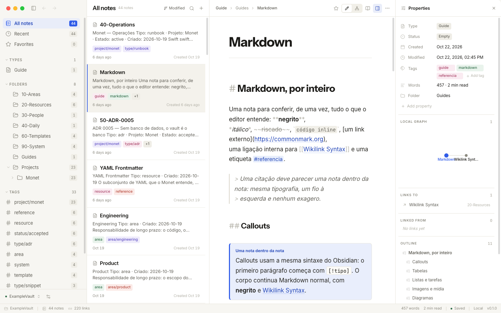
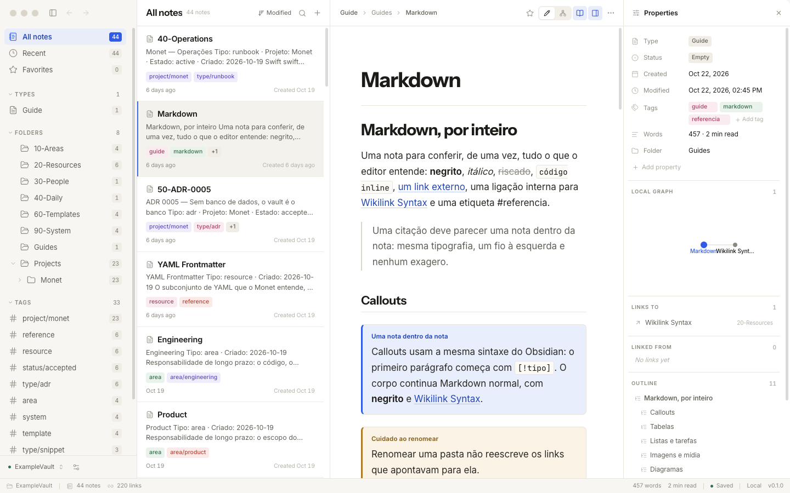
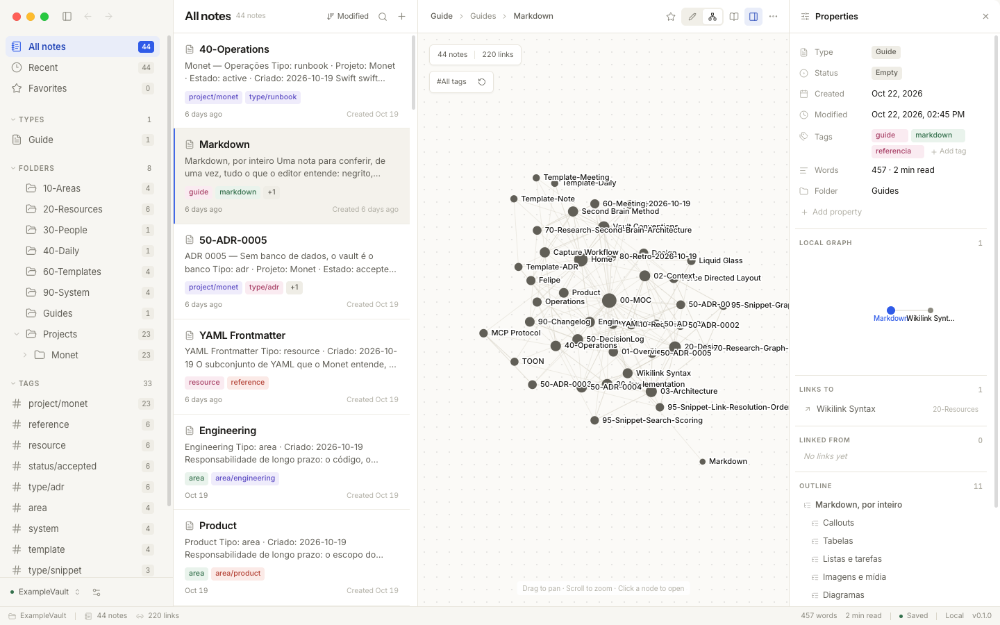
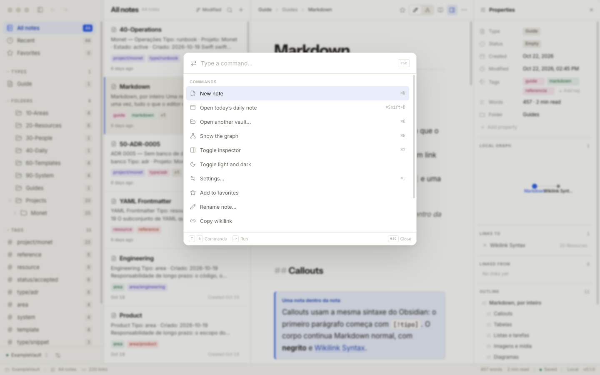
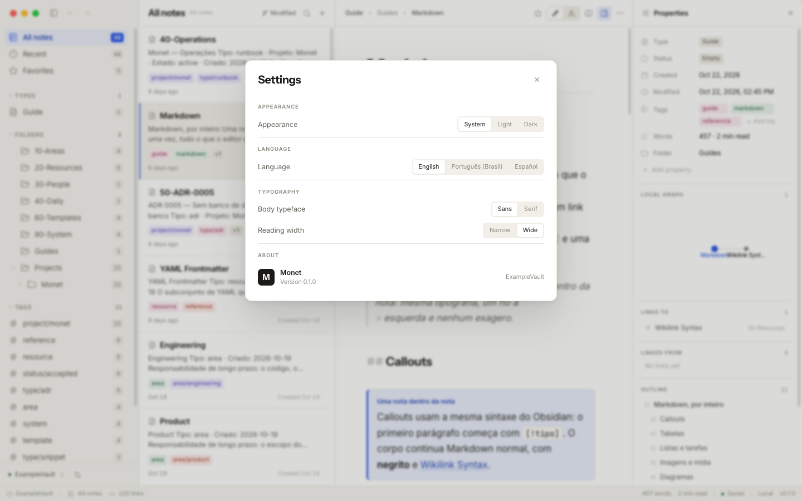
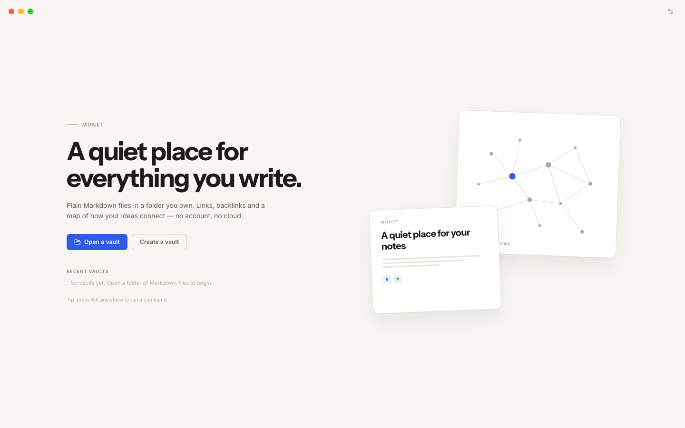

# Monet

**A quiet, local-first Markdown vault with an interactive graph, a rich editor, a CLI and an MCP server for AI agents.**

[](https://github.com/felipebarcelospro/monet/actions/workflows/ci.yml)
[](LICENSE)
[](https://nodejs.org)
[](CONTRIBUTING.md)

Monet stores notes as plain `.md` files in a folder you own. Links are
`[[wikilinks]]`, backlinks are indexed automatically, attachments resolve
relative to the vault, and the same folder is available to the desktop app,
the command line and AI agents — with no proprietary database in between.



---

## Contents

- [Features](#features)
- [Screenshots](#screenshots)
- [Requirements](#requirements)
- [Quick start](#quick-start)
- [Monorepo structure](#monorepo-structure)
- [The vault format](#the-vault-format)
- [Markdown support](#markdown-support)
- [Desktop application](#desktop-application)
- [Command line interface](#command-line-interface)
- [MCP server and agent skills](#mcp-server-and-agent-skills)
- [Architecture](#architecture)
- [Testing](#testing)
- [Contributing](#contributing)
- [Security](#security)
- [License](#license)

---

## Features

| | |
|---|---|
| **Local-first vault** | Plain Markdown files in any folder. YAML frontmatter, `[[wikilinks]]`, `![[embeds]]`, `#tags` and aliases. Link resolution follows Obsidian rules: case-insensitive, optional `.md`, aliases, and closest-folder tie breaking. |
| **Rich Markdown** | Tables, task lists, footnotes, images, video, audio, file attachments, Mermaid diagrams, KaTeX math, syntax-highlighted code, callouts and raw HTML. `⌘E` toggles a full reading view. |
| **Live editor** | CodeMirror 6 with tables, media, diagrams, display math and note embeds rendered in place; clicking a block returns to its Markdown. Task boxes are clickable. |
| **Interactive graph** | Deterministic force-directed graph with tag filtering, degree-based node sizing, hover inspection, pan and zoom. |
| **Command line interface** | Notes, search, backlinks, links, tags, the graph and vault switching. Human-readable output or `--format json` for scripts. |
| **MCP server for agents** | Exposes the vault to Claude Code, Cursor, Windsurf, Codex and any MCP client. Agents can search, read, create and link notes. |
| **Three languages** | English, Brazilian Portuguese and Spanish across the app, CLI and bundled skill. |
| **Cross-platform** | Electron on macOS, Linux and Windows, with a native-feeling frameless window. |

---

## Screenshots

| Editor | Reading view |
|---|---|
|  |  |

| Graph | Command palette |
|---|---|
|  |  |

| Settings | Welcome |
|---|---|
|  |  |

---

## Requirements

- **Node.js** 22 or later
- **pnpm** 11 or later
- **macOS**, **Linux** or **Windows**
- **Bun** (optional) — only to build the standalone CLI binaries

The app is developed and tested on macOS first; the other platforms use the
same Electron, Vite and Node code paths.

---

## Quick start

```sh
# 1. Install the workspace.
pnpm install

# 2. Create a deterministic demo vault in ExampleVault/.
pnpm seed

# 3. Run the desktop app with hot reload.
pnpm dev -- --vault ExampleVault
```

The app opens on the note you last edited. To use your own folder, press
`⌘O` (or `Ctrl+O`) and choose it, or run `monet vault use <path>` from the CLI.

### Build a desktop bundle

```sh
pnpm package
# macOS:  build/Monet.app
# Linux:  build/app
# Windows: build/app
```

The bundle is unsigned. On macOS, Gatekeeper asks for confirmation the first
time you open it.

### Use the CLI from anywhere

```sh
pnpm --filter @monet/cli build
cd packages/cli && pnpm link --global

monet vault current
monet note list
```

Prebuilt CLI binaries for macOS, Linux and Windows are published on the
[releases page](https://github.com/felipebarcelospro/monet/releases) when a `v*` tag
is pushed.

---

## Monorepo structure

| Package | What it is |
|---|---|
| **`@monet/core`** (`packages/core`) | Pure TypeScript engine: vault scanning, frontmatter, wikilinks, index, backlinks, search, graph, safe writes. Node and browser entry points. |
| **`@monet/cli`** (`packages/cli`) | The `monet` CLI, MCP server and agent skills. Built with [Incur](https://github.com/wevm/incur) so commands, schemas, completions and MCP tools come from one declaration. |
| **`@monet/app`** (`packages/app`) | Desktop application: Electron main process, preload bridge and React 19 renderer with CodeMirror 6. |

### Common scripts

```sh
pnpm dev            # Desktop app with hot reload
pnpm dev:cli        # CLI from source
pnpm build          # Build core, CLI and app
pnpm package        # Package the desktop app
pnpm test           # Vitest across all packages
pnpm typecheck      # TypeScript across all packages
pnpm lint           # Biome lint
pnpm format:check   # Biome formatting check
pnpm seed           # Seed ExampleVault/
pnpm screenshots    # Refresh docs/screenshots/
```

---

## The vault format

A vault is an ordinary folder. Monet never rewrites a file it did not have to
touch, and everything it writes is plain Markdown.

```markdown
---
title: Release Plan
tags: [project, release]
aliases: [Plan]
---

# Release Plan

The release ships on Friday. See [[Design Notes]] and ![[Checklist]].

Tagged #project and #area/product.
```

- **Wikilinks** — `[[Note]]`, `[[Note|display text]]`, `[[Note#Heading]]`, `[[#Heading]]`.
- **Embeds** — `![[Note]]`, `![[image.png]]`, `![[report.pdf]]`.
- **Tags** — `#tag`, `#nested/tag`, or a `tags` list in the frontmatter.
- **Aliases** — `alias` or `aliases` in the frontmatter.

Notes are indexed on open and on change; the index is derived state, never a
second source of truth.

---

## Markdown support

| Syntax | Renders as |
|---|---|
| A pipe table (GFM) | A bordered table with aligned columns and horizontal scroll. |
| `- [ ]` / `- [x]` | A task list; boxes are clickable in the editor. |
| `**bold**`, `*italic*`, `~~struck~~`, `` `code` `` | Inline formatting. |
| `[[Note]]`, `[[Note\|label]]` | An internal link that opens the note. |
| `![[Note]]` | The note itself, embedded one level deep. |
| `![[image.png]]`, `` | The image, resolved relative to the note or anywhere in the vault. |
| `` | A video player; mp3, wav, m4a and flac play inline too. |
| `![[report.pdf]]` | A file card that opens the attachment in its own app. |
| A `mermaid` fence | Flowchart, sequence, class, state, ER or gantt diagram. |
| `$…$`, `$$…$$` | KaTeX math, inline and display. |
| A `ts` fence | Syntax-highlighted code with a language label. |
| `[^1]` | GFM footnotes with a backlink. |
| `> [!note]` | A callout: note, tip, warning, caution, important, quote and friends. |
| `<details>`, `<kbd>`, raw HTML | Passed through, for what Markdown cannot express. |

Tables, media, diagrams, display math, callouts and embeds are rendered in
place while the cursor is elsewhere; clicking the block puts the cursor back
in the Markdown. `⌘E` opens the reading view, where the whole note is rendered
at once.

Raw HTML is rendered as written. A vault is trusted input: only open notes and
vaults you trust. See [SECURITY.md](SECURITY.md).

---

## Desktop application

- **Three columns** — sidebar (folders, tags, favourites), note list, editor,
  with an inspector for properties, backlinks, outgoing links and the outline.
- **Editor** — CodeMirror 6, wikilink autocomplete, live blocks, dirty-state
  aware saving, per-note history, favourites and reading time.
- **Reading view** — `⌘E`, or the book button, renders the note with editorial
  typography, tables, media, diagrams, math and embeds.
- **Graph** — the whole vault as a deterministic force-directed canvas. Filter
  by tag, click a node to open the note.
- **Command palette** — `⌘K`, plus `⌘P` for the quick switcher.
- **Inspector** — metadata, aliases, tags, word count, reading time, backlinks,
  outgoing links and the document outline.
- **Preferences** — theme, locale, sort order, editor width and body font.
- **Welcome** — create a vault or open an existing folder; recent vaults are
  remembered.

Keyboard shortcuts follow macOS conventions with `Ctrl` on Linux and Windows.

---

## Command line interface

```sh
# Notes
monet note new "Release Plan" --folder Projects --tag project
monet note list --tag project
monet note show "Release Plan" --links
monet note edit "Release Plan" --append "Ship on Friday."
monet note move "Release Plan" --to "Archive/Release Plan"
monet note delete "Release Plan" --yes

# Search, links and the graph
monet search "release" --limit 20
monet backlinks "Design Notes"
monet link create "Checklist" --target "Design Notes"
monet graph --format json
monet tags

# Vaults
monet vault use ~/Documents/Vault
monet vault current
monet vault list
monet open
```

Every command accepts `--format toon|json|yaml|md|jsonl`. The default is TOON,
compact for agents; use `--format json` for programs.

### Choosing the vault

Monet is designed around one vault. Point the CLI at it once:

```sh
monet vault use ~/Documents/Vault
```

That writes the shared configuration (`~/.config/monet/config.json`) — the same
file the app reads — and remembers the folder. From then on every command
works without `--vault`:

```sh
monet note list
monet search "release"
monet graph --format json
```

`monet vault current` shows the path in use, where it came from and how many
notes it holds. `monet vault list` shows the current vault and the ones opened
recently, including folders that no longer exist.

The resolution order is: `--vault`, `MONET_VAULT`, the configured vault, then
the current directory. An MCP server can be pinned with `MONET_VAULT`, while an
interactive terminal can switch with `monet vault use`. The app follows the
same configuration, so `monet open` and the next launch of the window use the
same folder.

---

## MCP server and agent skills

Monet speaks the Model Context Protocol over stdio:

```sh
monet --mcp          # Start the MCP server
monet mcp add        # Register it with the MCP clients it finds
monet skills add     # Install the Monet skill for supported agents
monet mcp doctor     # Validate startup and tool listing
```

Tools exposed to agents include `search`, `note_show`, `note_new`, `note_list`,
`backlinks`, `graph`, `link_create`, `vault_list`, `vault_current` and
`vault_use`. The server uses the configured vault, so an agent sees the same
folder as the app.

To pin a server to a vault without changing the global configuration:

```sh
MONET_VAULT=~/Documents/Vault monet --mcp
```

The bundled skill in `MonetSkill/` is authored in English, Portuguese and
Spanish; it teaches agents to run `monet vault current` before reading or
writing and never to guess a path.

---

## Architecture

Monet is three packages around one engine. The app and the CLI are both
clients of `@monet/core`; the renderer never touches the disk directly.

```
Electron main ── IPC ── preload ── React renderer
      │                               │
      └──────── @monet/core ──────────┘
                     │
               Markdown files
```

Read [ARCHITECTURE.md](ARCHITECTURE.md) for the IPC contract, the `monet://`
asset protocol, the Markdown pipeline, the index and the save model.

---

## Testing

```sh
pnpm test
```

Vitest runs across `@monet/core`, `@monet/cli` and `@monet/app`. The parser
contract is verified against the fixtures in `Fixtures/`, and the app tests
cover the vault service, target resolution and link handling.

```sh
pnpm typecheck
pnpm lint
pnpm format:check
```

CI runs all of them on every push and pull request.

---

## Contributing

Contributions are welcome — code, docs, translations, bug reports and
screenshots. Read [CONTRIBUTING.md](CONTRIBUTING.md) for setup, workflow and
the review checklist, and [CODE_OF_CONDUCT.md](CODE_OF_CONDUCT.md) for the
community rules.

Good first issues are labelled `good first issue`. If you are unsure where a
change belongs, open a discussion or an issue before writing code.

---

## Security

Please do not open a public issue for a vulnerability. Use GitHub's private
vulnerability reporting (Security → Advisories) and read
[SECURITY.md](SECURITY.md) for the scope and the trust model.

---

## License

MIT © Monet contributors. See [LICENSE](LICENSE).
